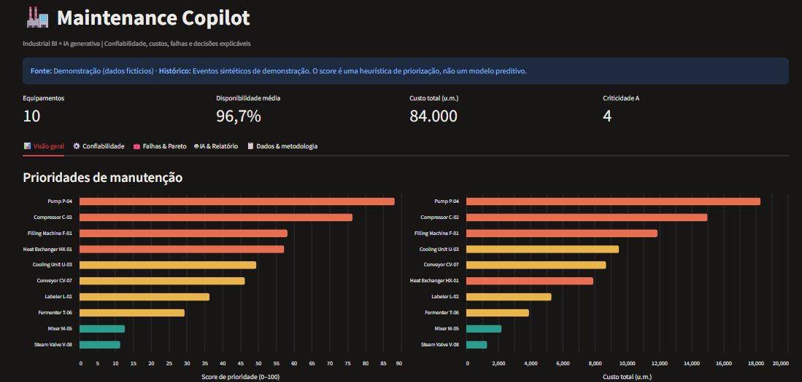
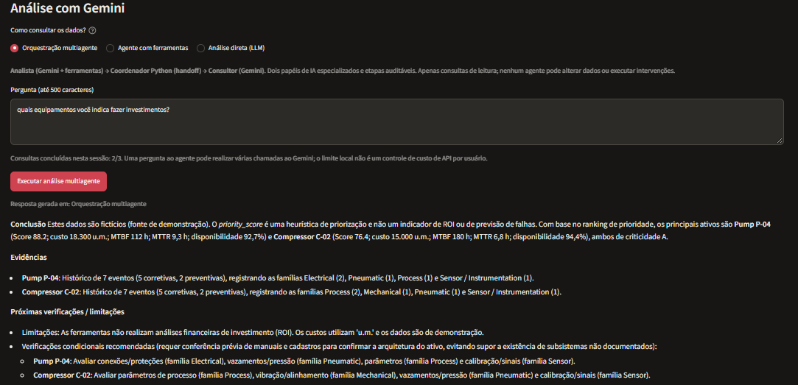

# AI Maintenance Copilot

### From Industrial BI to Multi-Agent AI

**An AI-powered decision-support application combining industrial analytics, reliability indicators, and intelligent maintenance recommendations.**

Built with **Python, Streamlit, Pandas, Gemini API, Function Calling, and Multi-Agent Orchestration**.

---

## Overview

Maintenance teams need to turn equipment performance data into actionable decisions.

**AI Maintenance Copilot** transforms maintenance indicators and intervention histories into interactive dashboards, equipment prioritization, and AI-powered technical analysis.

The project combines traditional **Business Intelligence** with **Generative AI**, allowing users to investigate maintenance priorities through natural-language questions supported by structured data.

## Application Demo

### 1. Industrial Maintenance Dashboard

Interactive visualization of equipment performance, reliability, and maintenance costs.



**Key capabilities:**
- Equipment availability and criticality analysis
- MTBF and MTTR indicators
- Maintenance cost monitoring
- Equipment priority ranking
- Corrective versus preventive maintenance analysis
- Failure-family analysis and Pareto charts
- CSV and Excel data integration

### 2. Multi-Agent AI Analysis

The application allows users to ask technical questions and receive recommendations supported by maintenance data.



**Available AI modes:**

| Mode | Functionality |
|---|---|
| Direct LLM | Gemini generates explanations using structured maintenance data |
| Tool-Calling Agent | Gemini retrieves equipment information through Python functions |
| Multi-Agent Orchestration | Two specialized Gemini agents collaborate through a Python coordinator |

---

## Project Evolution

The application evolved from a traditional analytics tool into a multi-agent AI system.

| Stage | Development | Main Competency |
|---|---|---|
| **01 — Industrial BI** | Interactive dashboards, reliability indicators, and equipment prioritization | Data Analytics |
| **02 — Generative AI** | Gemini integration for natural-language maintenance analysis | LLM Integration |
| **03 — Function Calling** | Gemini executes authorized Python data-retrieval functions | AI Tool Use |
| **04 — Multi-Agent AI** | Specialized Analyst and Consultant agents with structured evidence transfer | Agent Orchestration |

This evolution demonstrates how conventional data analytics can be extended into an AI-assisted decision-support workflow.

## Multi-Agent Architecture


### Multi-Agent Workflow

```text
     Maintenance Data (CSV / Excel)
                  |
                  v
          Python + Pandas
         (KPIs and Analytics)
                  |
                  v
         Streamlit Dashboard
                  |
                  v
           GEMINI ANALYST
                  |
                  | Function Calling
                  v
        Read-Only Python Tools
                  |
                  v
         PYTHON COORDINATOR
        (Structured Evidence)
                  |
                  v
          GEMINI CONSULTANT
                  |
                  v
       Final Recommendations
          + Audit Trace
```


### Agent 1 — Maintenance Analyst

The Analyst interprets user questions and retrieves supporting information through Python tools.

It can explore:
- Equipment prioritization
- Maintenance costs
- MTBF and MTTR
- Equipment-specific failure history
- Recorded maintenance interventions

### Python Coordinator

The coordinator manages the analysis workflow, collects tool outputs, enriches the evidence with equipment-specific information, and transfers structured data between the agents.

### Agent 2 — Maintenance Consultant

The Consultant receives the collected evidence and generates technical explanations, recommendations, and suggested verification actions.

The application also provides an **auditable execution trace**, allowing users to inspect tool calls and information exchanged throughout the workflow.

---

## Example Use Case

**User question:**

> Which equipment should be prioritized based on maintenance costs, MTBF, MTTR, and recorded failure history?

**AI workflow:**

1. Identify the highest-priority equipment.
2. Retrieve reliability and maintenance indicators.
3. Consult equipment-specific intervention histories.
4. Transfer structured evidence between AI agents.
5. Generate recommendations and explain the supporting information.

The final analysis combines numerical indicators, maintenance history, and AI-generated explanations.

---

## Validation & Results

**28 automated tests passed** in the V6.2 development environment.

The project was also tested locally using demonstration datasets, including an alternative scenario containing **14 equipment assets and recorded maintenance events**.

**Validated capabilities:**

- Maintenance data processing and validation
- Equipment prioritization and KPI analysis
- Python Function Calling
- Structured evidence retrieval
- Sequential multi-agent coordination
- Execution trace and tool-call logging
- Gemini-powered maintenance analysis

The application uses synthetic datasets for its portfolio demonstrations.

---

## Technology Stack

| Technology | Application |
|---|---|
| **Python** | Application development and data processing |
| **Streamlit** | Interactive web application |
| **Pandas** | Industrial data analytics |
| **Gemini API** | Generative AI integration |
| **Function Calling** | LLM interaction with Python tools |
| **Multi-Agent Orchestration** | Coordination between specialized AI roles |
| **ReportLab** | Automated report generation |
| **Pytest** | Automated software testing |

---

## Run Locally

### 1. Clone the repository

```bash
git clone https://github.com/ioglas-af/ai-maintenance.git
cd ai-maintenance
```

### 2. Create a Python environment

```powershell
python -m venv .venv
.\.venv\Scripts\Activate.ps1
```

### 3. Install dependencies

```powershell
python -m pip install -r requirements.txt
```

### 4. Configure Gemini

Create a file named `.streamlit/secrets.toml`:

```toml
GEMINI_API_KEY = "YOUR_GEMINI_API_KEY"
```

Keep API keys private and outside version control.

### 5. Launch the application

```powershell
python -m streamlit run app.py
```

Open **http://localhost:8501**.

### Run automated tests

```powershell
python -m pytest -q
```

---

## Repository Structure

```text
ai-maintenance/
├── app.py
├── analytics.py
├── agent_gemini.py
├── agent_tools.py
├── multiagent.py
├── report_pdf.py
├── requirements.txt
├── assets/
│   ├── dashboard-overview.png
│   └── maintenance-ai-tab.png
├── data/
├── tests/
└── README.md
```

---

## Author

**Ioglas Alves da Fonseca**

Electrical Engineering | Industrial Systems | Automation | Applied Artificial Intelligence

**Related project:** [Industrial Maintenance Analytics](https://github.com/ioglas-af/industrial-maintenance)
