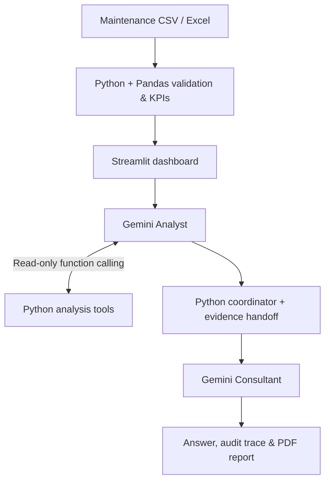
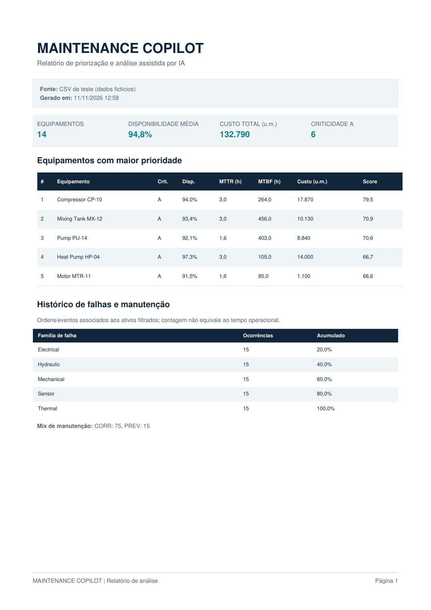

# AI Maintenance Copilot

**Industrial analytics meets generative AI.** A Streamlit decision-support prototype that turns maintenance indicators and event histories into asset-priority dashboards, grounded explanations, and PDF reports.


*Real screenshot from an earlier local dashboard iteration, using synthetic data. The latest interface may differ.*

## What problem does it solve?

Maintenance teams need to make sense of reliability, downtime, costs, and corrective interventions across multiple assets. This prototype brings those indicators together and lets a user ask **which equipment deserves attention—and why**.

## What it does

- **Industrial BI:** availability, MTBF, MTTR, maintenance cost, criticality, and asset prioritization.
- **Historical analysis:** corrective vs. preventive events and recorded failure-family patterns.
- **AI explanations:** ask questions about the loaded dataset through Gemini.
- **Three analysis modes:** direct LLM, tool-calling agent, or sequential two-agent orchestration.
- **Auditable answers:** read-only Python tools, evidence handoff, and execution trace.
- **Reporting:** export a PDF summary based on the analysis.
- **Import your own data:** supported CSV/Excel formats, with input validation.

## Architecture



The multi-agent option uses **two separate Gemini roles** coordinated sequentially by Python. It is *not* autonomous industrial decision-making, a multi-provider system, or dynamic agent delegation. The recommendations are for human review.

## Evidence and testing

- **28 automated tests passed** in the V6.2 build environment.
- A local multi-agent demonstration was exercised using an **alternative synthetic dataset with 14 assets and intervention histories**.
- The application displays actual tool calls and the separation between Analyst, Python coordinator, and Consultant.
- An example PDF was generated from synthetic test data and inspected for readability.

**Important:** these are software and demonstration checks—not proof of predictive accuracy, real-world savings, or validated maintenance diagnoses.

### Example report



*Sample report generated using synthetic data and illustrative analysis; not a screenshot of a live Gemini response.*

## Run locally

Requires Python 3.11+.

```powershell
python -m venv .venv
.\.venv\Scripts\Activate.ps1
python -m pip install -r requirements.txt
python -m streamlit run app.py
```

Open **http://localhost:8501**. The demo dashboard works without a Gemini key. To enable AI analysis, create `.streamlit/secrets.toml`:

```toml
GEMINI_API_KEY = "YOUR_OWN_GEMINI_KEY"
```

The selected Gemini model must be enabled for your Google project. **Never commit the real key**; the repository includes a `.gitignore` and a safe example configuration.

For a demonstration, use the sample datasets in `data/`. To run the offline tests:

```powershell
python -m pytest -q
```

## Technology

**Python · Streamlit · Pandas · Gemini API · Function Calling · Sequential Multi-Agent Orchestration · PDF Reporting · Pytest**

## Limitations

This is a **portfolio prototype** using synthetic data. Its priority score is a transparent heuristic, **not predictive maintenance**. MTBF and MTTR are imported metrics; historical failure categories do not establish root causes or prove that particular physical components exist. Currency is generic. Gemini outputs require human verification. When an AI mode is selected, some user-provided data may be transmitted to Google's API—use only authorized data.

---

**Author:** Ioglas Alves da Fonseca  
**Related work:** [Industrial Maintenance Analytics](https://github.com/ioglas-af/industrial-maintenance)
