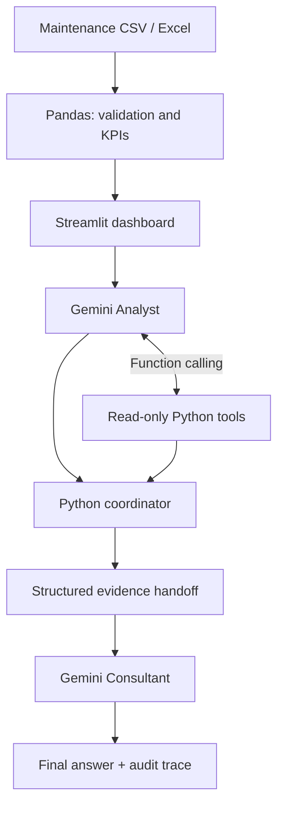

# AI Maintenance Copilot

**From industrial BI to auditable multi-agent AI.**

A Streamlit application for exploring maintenance KPIs, prioritizing assets, analyzing recorded failures, and asking evidence-grounded questions with Gemini. Built as a portfolio demonstration with **synthetic data**.


## Why this project?

Maintenance teams work with availability, repair times, costs and intervention records, but turning those indicators into decisions can require several separate analyses. This project combines an interactive BI dashboard with an AI assistant that can retrieve supporting evidence through read-only Python functions.

## What you can do

- Explore **availability, MTBF, MTTR, maintenance cost and equipment criticality**.
- Compare equipment using an **explicit heuristic priority score** (not a prediction of failures).
- Inspect corrective/preventive events and **failure-family patterns** when event data are available.
- Import synthetic demonstration data or authorized CSV/Excel data.
- Ask questions using three modes: **direct LLM, tool-calling agent, or sequential multi-agent workflow**.
- Inspect tool execution and evidence handoff; export a summary if needed.

## Real application screenshots

### 1. Maintenance dashboard


### 2. Multi-agent analysis — live local demonstration


The images show the application running locally. Demonstration data are synthetic; the Gemini service requires a valid API key and available quota.

## How the project evolved

| Stage | Technical capability added |
| --- | --- |
| **1 — Industrial BI** | KPI dashboard, asset ranking, reliability and maintenance-event analytics |
| **2 — Gemini integration** | Natural-language explanations using the loaded dataset |
| **3 — Function Calling** | LLM-selected **read-only Python tools** with inspectable outputs |
| **4 — Multi-agent orchestration** | Separate Analyst and Consultant Gemini roles, coordinated by Python with a structured evidence handoff |

## Multi-agent architecture



The **Analyst** can query authorized Python tools for asset rankings, details and failure history. The **Python coordinator** passes actual tool outputs and relevant asset-specific event evidence to the **Consultant**, which drafts conditional recommendations. This is a **sequential two-agent design**, not autonomous maintenance control, dynamic delegation or a multi-provider system.

**Example question:**

> Which equipment should be prioritized based on maintenance costs, MTBF, MTTR and recorded failure history? Explain the evidence and recommend follow-up checks.

## Validation and evidence

- **28 automated tests passed** in the V6.2 development environment, covering data handling, read-only tools and mocked agent coordination.
- The multi-agent application was also exercised locally against synthetic data, including an alternative scenario with **14 assets and event history**.
- The UI exposes the steps of the Analyst, Python coordinator and Consultant and records executed tool calls.

These are **software and functional demonstrations**, not measurements of predictive accuracy, financial savings or industrial reliability improvements.

## Technology

**Python · Streamlit · Pandas · Gemini API · Function Calling · Multi-Agent Orchestration · ReportLab · Pytest**

## Run locally (Windows PowerShell)

```powershell
python -m venv .venv
.\.venv\Scripts\Activate.ps1
python -m pip install -r requirements.txt
```

For Gemini analysis, create `.streamlit/secrets.toml` locally:

```toml
GEMINI_API_KEY = "YOUR_GEMINI_API_KEY"
```

Then start:

```powershell
python -m streamlit run app.py
```

Open <http://localhost:8501>. The BI dashboard runs without Gemini. Generative-AI modes require model access and available API quota.

Run the offline tests:

```powershell
python -m pytest -q
```

**Never commit API keys or `.streamlit/secrets.toml`.** This repository includes only a safe example configuration.

## Repository structure

```text
app.py                 Streamlit application
analytics.py           KPI processing and data validation
agent_tools.py         Read-only maintenance data tools
agent_gemini.py        Gemini Function Calling
multiagent.py          Analyst -> Coordinator -> Consultant workflow
report_pdf.py          Optional PDF export
assets/                Real application screenshots
data/                  Synthetic examples
tests/                 Automated tests
docs/                  Demonstration notes
.github/               Contribution guidance
```

## Limitations

- Synthetic demonstration data; no real plant validation.
- Asset priority is a heuristic, **not predictive maintenance**.
- MTBF and MTTR are imported indicators, not recomputed from event history.
- Failure-family labels do not establish root causes or prove the presence of specific machine components.
- AI recommendations require human review; no physical interventions are executed.
- When AI mode is enabled, selected information is sent to Google's API; use only authorized datasets.

## Author

**Ioglas Alves da Fonseca** — Electrical Engineering · Industrial Systems · Applied AI

Related work: [Industrial Maintenance Analytics](https://github.com/ioglas-af/industrial-maintenance)
