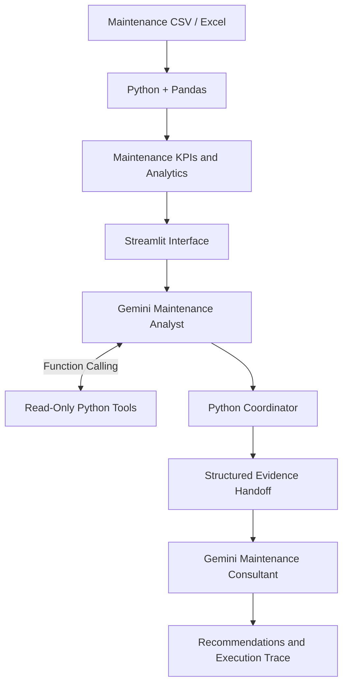

# AI Maintenance Copilot

**Industrial Analytics Meets Generative AI**

A Python-based decision-support application combining industrial maintenance analytics, reliability indicators, and generative AI to support equipment prioritization and explainable maintenance decisions.

Built with **Python, Streamlit, Pandas, Gemini API, Function Calling, and Multi-Agent Orchestration**.


## Overview

Industrial maintenance teams must analyze equipment availability, failure histories, maintenance costs, and reliability indicators to determine which assets require attention.

AI Maintenance Copilot combines these indicators into an interactive dashboard and allows users to investigate maintenance priorities using generative AI.

The application uses synthetic datasets for demonstration purposes.

## Key Features

### 1. Industrial Analytics Dashboard

- Equipment availability and criticality
- Mean Time Between Failures (MTBF)
- Mean Time To Repair (MTTR)
- Maintenance costs and prioritization
- Corrective versus preventive interventions
- Failure analysis and Pareto charts
- CSV/Excel data import

### 2. AI-Powered Maintenance Analysis

Users can ask questions about equipment performance, reliability, and maintenance priorities.

The application supports three analysis modes:

| Mode | Description |
|---|---|
| Direct LLM | Gemini analyzes structured maintenance information. |
| Tool-Calling Agent | Gemini invokes read-only Python tools to retrieve maintenance evidence. |
| Multi-Agent Orchestration | Two specialized Gemini roles collaborate through a Python coordinator. |

### 3. Multi-Agent Architecture

The advanced workflow separates responsibilities between two specialized AI roles and a deterministic Python coordinator.

**Agent 1 — Maintenance Analyst**

- Interprets the user's question.
- Calls Python tools to retrieve equipment information.
- Examines reliability indicators and maintenance priorities.
- Produces an initial evidence-based analysis.

**Python Coordinator**

- Collects the Analyst's findings.
- Organizes structured evidence.
- Transfers the information to the second agent.
- Maintains an auditable execution trace.

**Agent 2 — Maintenance Consultant**

- Reviews the Analyst's findings.
- Interprets maintenance risks and trade-offs.
- Produces actionable recommendations.
- Identifies uncertainties requiring human verification.



The multi-agent workflow is sequential. It does not implement autonomous equipment control, dynamic delegation, or independent industrial decision-making.

## Application Screenshots

### Maintenance Dashboard

Interactive visualization of equipment availability, costs, reliability indicators, and maintenance priorities.


### Multi-Agent AI Analysis

Real application demonstration showing Gemini-based maintenance analysis, Python tool execution, and the multi-agent workflow.


## Project Evolution

The project was developed incrementally to demonstrate the integration of industrial analytics and generative AI.

| Stage | Implementation |
|---|---|
| V1 — Industrial BI | Maintenance KPIs, equipment ranking, and dashboard |
| V2 — Generative AI | Gemini integration for maintenance questions |
| V3 — Tool Calling | Gemini connected to read-only Python analysis tools |
| V4 — Multi-Agent | Specialized Analyst and Consultant roles coordinated by Python |

This progression illustrates the transition from a conventional analytics application to an AI-assisted decision-support system.

## Example Use Case

**User question:**

> Which equipment should be prioritized considering maintenance costs, MTBF, MTTR, and failure history?

**Application workflow:**

1. Analyze the maintenance indicators.
2. Retrieve relevant equipment data using Python tools.
3. Compare maintenance priorities and reliability indicators.
4. Transfer structured evidence between the AI roles.
5. Generate recommendations and identify uncertainties.

Recommendations are based on the available dataset and require human technical validation.

## Technology Stack

| Technology | Application |
|---|---|
| Python | Application logic and data processing |
| Streamlit | Interactive web application |
| Pandas | Maintenance data analysis |
| Gemini API | Generative AI integration |
| Function Calling | LLM access to Python analysis tools |
| Multi-Agent Orchestration | Sequential coordination of specialized AI roles |
| ReportLab | PDF report generation |
| Pytest | Automated software testing |

## Installation

**Requirements:** Python 3.11+ and a Gemini API key for AI functionality.

Clone the repository:

```bash
git clone https://github.com/ioglas-af/ai-maintenance.git
cd ai-maintenance
```

Create a virtual environment:

```powershell
python -m venv .venv
.\.venv\Scripts\Activate.ps1
```

Install dependencies:

```powershell
python -m pip install -r requirements.txt
```

Create the file `.streamlit/secrets.toml`:

```toml
GEMINI_API_KEY = "YOUR_GEMINI_API_KEY"
```

Never commit your real API key.

Start the application:

```powershell
python -m streamlit run app.py
```

Open:

http://localhost:8501

The analytics dashboard can run without Gemini. AI analysis requires a valid API key, an accessible model, and available API quota.

## Testing and Validation

The V6.2 build passed **28 automated tests** in its development environment.

Testing covered:

- Maintenance analytics and data validation
- Python tool execution
- Multi-agent coordination
- Structured evidence transfer
- Application behavior

The application was also exercised with synthetic maintenance datasets, including a scenario with 14 assets and intervention histories.

These results demonstrate software functionality, not predictive accuracy or validated industrial maintenance outcomes.

To run the automated tests:

```powershell
python -m pytest -q
```

## Limitations

- Demonstration datasets are synthetic.
- Equipment prioritization uses a heuristic score, not a predictive maintenance model.
- MTBF and MTTR are imported indicators.
- AI-generated recommendations require human verification.
- The system does not perform autonomous maintenance interventions.
- The application is a portfolio prototype, not a production industrial system.
- Gemini availability and API quotas depend on Google's service.

## Author

**Ioglas Alves da Fonseca**

Electrical Engineering | Industrial Systems | Automation | Applied AI

**Related Project:** [Industrial Maintenance Analytics](https://github.com/ioglas-af/industrial-maintenance)
